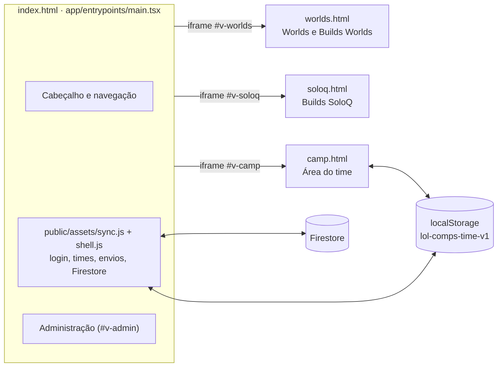

# Arquitetura do WebLol

Este documento é um mapa de como o WebLol funciona hoje. Para decidir onde fica um módulo novo, use a [skill de FSD](../.agents/skills/feature-sliced-design/SKILL.md). Os nomes dos conceitos estão no [glossário](glossario.md).

## Visão geral

- **Shell** (`src/index.html`, `src/app/entrypoints/main.tsx`): desenha o cabeçalho e as seções (Worlds, Builds, Área do time, Administração). Também carrega os scripts clássicos `sync.js` e `shell.js` com `loadClassicScript` e mostra um iframe por área.
- **Iframes**: cada área é uma página Vite própria. O shell troca a visível conforme a rota em `location.hash`.
- **Scripts clássicos** (`public/assets/sync.js` e `shell.js`): login por Riot ID, times, capitão, envios, versão oficial, backups e acesso ao Firestore. Ficam fora do Vite, do TypeScript e do FSD, e estão congelados para funcionalidades novas (veja as [convenções](convencoes.md#estrutura)).

## Entradas e builds

| Entrada | Arquivo de início | Conteúdo | Build |
| --- | --- | --- | --- |
| `index.html` | `app/entrypoints/main.tsx` | Shell e Administração | `vite build` |
| `worlds.html` | `app/entrypoints/worlds.ts` | Visão geral, Composições do Worlds e Builds Worlds | `vite build` |
| `camp.html` | `app/entrypoints/team.ts` → `pages/team` | Área do time | `vite build` |
| `soloq.html` | `app/entrypoints/soloq.ts` (reaproveita `worlds.ts`) | Builds SoloQ | `vite build --mode soloq` |

O alias `@dataset/*` aponta para `src/data/` no build normal e para `src/data/soloq/` no modo `soloq`. O `npm run build` roda `npm run check` e os dois builds, que saem em `dist/` e `dist-soloq/`.

## Comunicação entre o shell e os iframes

Os iframes são da mesma origem, então a comunicação acontece por três caminhos. Todos são implícitos e sem tipo compartilhado, o que a [auditoria](auditoria-codebase.md) trata como dívida.

1. **Eventos** (`CustomEvent`), disparados no `frameElement` do iframe ou no `document` do shell:

   | Evento | Direção | Para quê |
   | --- | --- | --- |
   | `weblol:navigate` | iframe → shell | Pedir uma troca de rota |
   | `weblol:route-ready` | iframe → shell | Avisar que a rota foi aplicada |
   | `weblol:analytics`, `weblol:analytics-clear` | iframe → shell | Mostrar e limpar o tooltip de análise (`analytics-bridge.tsx`) |
   | `weblol:close-account` | `shell.js` → cabeçalho React | Fechar o menu da conta |

2. **Funções globais**: o shell chama `frame.contentWindow.applyWebLolRoute(...)` para aplicar a rota no iframe e `weblolTeamChanged()` para avisar que o time mudou. A Área do time lê do `window.parent` as funções `captainAccess`, `canManageTeam`, `TEAM_NAME`, `renderCaptainPanel` e `weblolImages`, definidas em `shell.js`. O shell expõe `startSignup` para o botão Entrar.
3. **Armazenamento compartilhado**: `sync.js` grava o estado do time em `localStorage["lol-comps-time-v1"]`, que a Área do time lê e escreve. O `sync.js` escuta o evento `storage` dessa chave para atualizar o status. Depois de sincronizar, trocar de time ou sair, o `reloadCamp()` recarrega o iframe da Área do time por `srcdoc`.

## Camadas (Feature-Sliced Design)

| Camada | Slices atuais |
| --- | --- |
| `app` | `entrypoints` (main, worlds, team, soloq, analytics-bridge), `config/ui-versions.ts`, `styles` |
| `pages` | `builds`, `team`, `worlds-compositions`, `worlds-overview` |
| `widgets` | `analytics-tooltip`, `tactical-map`, `team-knowledge`, `tournament-overview` |
| `features` | `select-theme` |
| `entities` | `ability`, `account`, `champion`, `match`, `tactical-play` |
| `shared` | `config` (dataset, tema), `lib` (motion, analytics-dom, utils), `ui` (botões, Arc UI, ReUI) |

O `scripts/check-architecture.mjs` (dentro do `npm run check`) confere a direção dos imports, o uso das APIs públicas e falha quando um arquivo novo passa de 299 linhas não vazias ou usa `@ts-nocheck`. Os arquivos antigos ficam nas listas `legacyLongFiles` e `legacyNoCheckFiles` do script e só podem encolher.

## Dados

| Dado | Onde fica | Quem gera |
| --- | --- | --- |
| Partidas e drafts do Worlds | `src/data/worlds*.json` | `scripts/worlds-build-timeline.py` e coleta do gol.gg |
| Partidas SoloQ dos pros | `src/data/soloq/` | `scripts/soloq.py`, todo dia pelo workflow `soloq.yml` |
| Catálogo e imagens da Riot | `src/data/lol.json`, `public/assets/lol/` | `scripts/download-lol-assets.py` (Data Dragon) |
| Ícones da interface | `public/assets/icons.svg` (ignorado no Git) | `scripts/build-icons.mjs` antes do `dev` e do `build` |
| Times, contas, envios e versão oficial | Firestore, regras em `firestore.rules` | `sync.js` e `shell.js` |
| Estado local da Área do time e preferências | `localStorage` e IndexedDB | Área do time, Mapa tático, `sync.js` |

A lista completa de coleções, chaves e rotas está nos [nomes salvos do glossário](glossario.md#nomes-salvos-contratos). A versão oficial de cada time é assinada pelo admin, e os envios e backups são criptografados no navegador para a chave do admin. O histórico dessa área fica em [historico-admin-login.md](historico-admin-login.md).

## Publicação

1. Todo push na `main` (exceto mudanças só de documentação) dispara o workflow `.github/workflows/deploy.yml`.
2. O workflow roda `npm run build` e o `scripts/prepare-pages.mjs`, que junta `dist/` e `dist-soloq/` em `_site/` e acrescenta `?v=<hash>` aos ativos de `public/`.
3. `_site/` é publicado no GitHub Pages como artefato. Nada gerado fica no Git.
4. O workflow `.github/workflows/soloq.yml` roda todo dia: coleta as partidas com o segredo `RIOT_API_KEY`, commita só `src/data/soloq/` na `main` e chama o `deploy.yml`.
5. `npm run pages:prepare` faz o mesmo build localmente em `_site/`.

A skill [weblol-publicar](../.agents/skills/weblol-publicar/SKILL.md) descreve o passo a passo. A decisão está na [ADR 0003](decisoes/0003-publicacao-por-artefato.md).

## Testes

Os testes Playwright ficam em `tests/` e sobem o Vite na porta 5180 com Chrome desktop. Rode `npm test` para a suíte inteira ou `npx playwright test tests/<arquivo>.spec.ts` para uma área. Os testes unitários rodam com `npm run test:unit` (Vitest), e `npm run verify` junta Biome, `check`, Knip e os unitários. As escolhas estão na [ADR 0004](decisoes/0004-ferramentas-de-qualidade.md).
